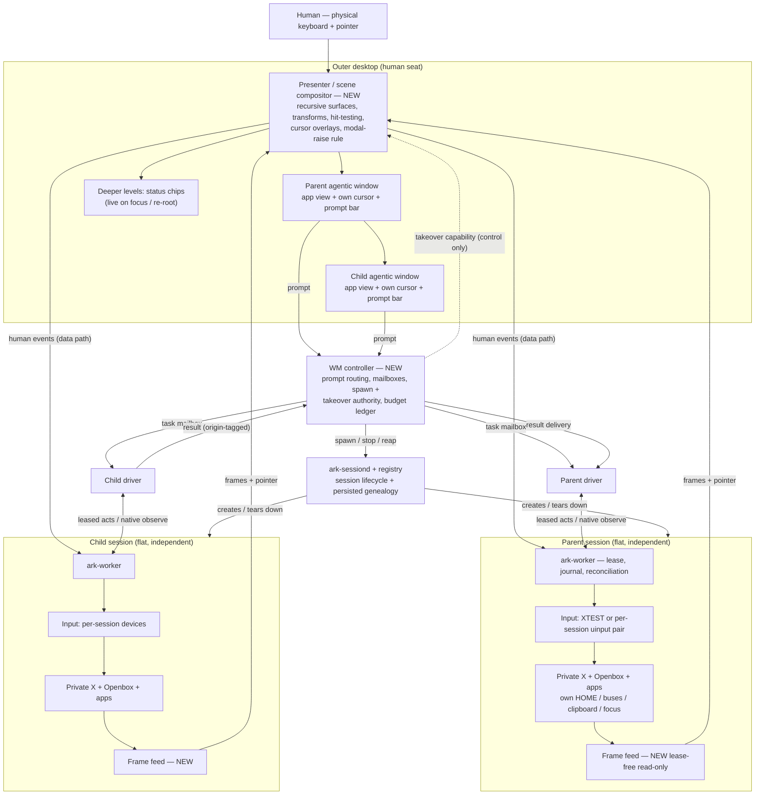

# ArkDrive OS — Window Manager v1 Architecture (Council-reconciled)

Status: reconciled Nov 11, 2026 from Council WM-v1 round 1 + cross-check.
Sources: hidden_files/COUNCIL-WMV1-CODEX-R1.md, COUNCIL-WMV1-FABLE-R1.md,
COUNCIL-WMV1-CODEX-XCHECK.md, COUNCIL-WMV1-FABLE-XCHECK.md.
The locked model (ArK, Nov 11, 2026) is the input, not a proposal:
per-session cursor/keyboard, agentic windows with prompt bars,
window-in-window nesting, test target = x86 Debian generic VM.

## Verdict

Feasible on the current stack. Children are physically flat, independent
sessions; nesting exists only in (a) the genealogy registry and (b) the
presentation layer. No proven invariant (lease fencing, session-local
modality, reconciliation, host exclusion) is broken by the model itself.
Three things are genuinely new work: a nested presenter, a lease-free
read-only frame feed, and a human takeover path. Live promotion is out:
promotion = save/export, spawn, reopen, verify child, then retire source.

## Reconciled decisions on the cross-check disputes

1. **Frame source — repo wins over pitch wording.** Raj verified: there is
   no Xpra code in wm/, src/, tools/, or tests/, and the build spec lists
   Xpra/console as not built. The only frame path is the worker's
   lease-bound observe. V1 therefore builds a **lease-free, read-only
   frame feed** served by each worker (frames + pointer position; cursor
   image/hotspot is new worker surface, added explicitly). Presenter
   frames get their own quota, separate from the driver's PNG quota.
2. **Child placement — host-side presenter overlay for v1.** No foreign
   window is injected into any session (the slot window's focus/stacking/
   enumeration side effects against an active parent are unqualified).
   The overlay's known weakness (a parent dialog can sit under a child
   surface) is handled by a presenter rule: when a session's worker
   reports a modal/dialog, the presenter raises that session's native
   dialog region above child surfaces and marks child surfaces
   non-hit-testable until it clears. The slot window stays the fallback
   if the VM test shows this rule is insufficient.
3. **Session caps — structural, admission by measurement.** Hard
   structure: depth 3, fan-out 4 per parent. Admission: start at 2 live
   sessions on the VM, raise to 3, then 4 only by the N=1–4 measurement
   run. No fixed "3 total" product cap; 30 display slots are an allocator
   bound, not capacity. Collapsed sessions count toward admission.
4. **Control plane — thin WM controller + durable registry in sessiond
   state.** A new long-running WM controller owns prompt routing,
   mailboxes, spawn/takeover authority, and the budget ledger.
   Genealogy (parent, root, task id, depth, budget allocation, incarnation
   id) is persisted in the sessiond registry, not held only in the
   controller, so killing the controller mid-tree never orphans a
   subtree: sessiond state alone must be sufficient to reap a tree.
   Session IDs are never trusted alone; every message binds a stable
   incarnation id.
5. **Human data path — capability, not relay.** The controller issues a
   session-scoped takeover capability; human events then flow
   presenter → worker → input backend directly (a controller stall must
   never freeze a human mid-drag). Takeover sequence: resolve session →
   close admission → epoch bump → revoke lease → release all holds
   (interrupted effects recorded partial/unknown, never replayed) →
   HUMAN mode on the same devices/grabs → on release, fresh driver
   attach + observation + reconciliation before automation resumes.
   Human keystrokes are journaled as counts, never content.
6. **Live visual depth — 2 levels live.** Parent + its children render
   live; grandchildren and deeper render as status chips until focused,
   at which point the view re-roots. Depth cap (3) is structural;
   live-render depth is a presentation budget.
7. **Test order — headless first, then the full nested test.** Gate 1
   (headless): isolation/gate tests with the presenter absent — spawn
   gating by parent control state, budget debit across the tree,
   kill-cascade order, controller-kill subtree reap. Gate 2: Codex's
   full scenario — one Xorg child in one Xorg parent, simultaneous
   tagged input, move/resize/focus/collapse/expand, parent modal, child
   takeover mid-sequence; zero cross-deliveries, stale-epoch rejections,
   no replay after presenter/helper kills. Then grandchild + N=1–4
   measurement.

## Standing rules carried from both rounds

- One driver, one ordered mutation queue per session. A parent driver
  observes only its native session and never injects into a child;
  children are delegates reached through the controller, never extra
  actionable windows in the parent's session.
- Presentation focus ≠ session focus. Selecting a preview changes
  neither the session's pointer nor its focused app.
- Move/resize = presenter transforms only; session resolution is fixed
  in v1. Composite each source surface once at the host; never
  recursively re-encode composed parents.
- Budgets are debited from the parent's ledger, never copied or minted;
  lease-local accounting cannot enforce family budgets alone.
- Results cross sessions only through the controller, with origin
  tagging; a child's result text is untrusted input to the parent driver.
  Cross-HOME file handoff goes through an explicit controller-mediated
  transfer, not shared filesystems.
- Collapse is presentation-only: the session, driver, devices, and task
  continue headless. A collapsed/blocked descendant must surface an
  attention signal on its chip.
- Promotion (v1): quiesce source → save/export + reopen manifest →
  spawn child session → transfer selected documents/clipboard explicitly
  → reopen and verify → only then retire the source. Undo history,
  in-memory state, selections, and logins do not transfer.

## Architecture



```text
 HUMAN ──► PRESENTER (host) ── draws ──► ┌ Parent agentic window ─────────┐
              │                          │  app view · own cursor          │
              │                          │  ┌ Child agentic window ────┐ │
              │                          │  │ app view · own cursor     │ │
              │                          │  │ [child prompt bar]        │ │
              │                          │  └────────────────────────────┘ │
              │                          │  [parent prompt bar]            │
              │                          └─────────────────────────────────┘
              │ human events (takeover, capability from controller)
              ▼                frames ▲ (new lease-free worker feed)
 WM CONTROLLER ──► sessiond+registry (genealogy persisted)
      │ task mailboxes        │
      ▼                       ▼
 Parent driver ◄─lease─► Parent worker ─► own input devices ─► own X/apps
 Child driver  ◄─lease─► Child worker  ─► own input devices ─► own X/apps
      Sessions are flat siblings at runtime; nesting is registry + drawing.
```

## Component table

| Component | Owns | Talks to |
|---|---|---|
| Presenter (new) | Surfaces, transforms, hit-testing, cursor overlays, modal-raise rule, prompt-bar chrome | Frame feeds, controller, workers (human data path) |
| WM controller (new) | Prompt routing, mailboxes, spawn/takeover authority, budget ledger | Presenter, sessiond, drivers |
| sessiond + registry | Session lifecycle, persisted genealogy/incarnation ids | Controller, X servers, workers |
| Worker (per session) | Lease/epochs, journal, reconciliation, frame feed, human-path admission | Driver, controller, input backend |
| Driver (per session) | Task reasoning, per-app knowledge packs | Controller mailbox, its worker only |
| Input backend | Per-session uinput pair / XTEST, grabs, hold tracking | Worker, owning X server only |
| Session X/Openbox/apps | Native windows, session focus, clipboard | Worker sensing, frame feed |

## Top risks (merged)

1. Takeover authority races and held-input lifetime across the transition.
2. Shell truth vs session truth diverging (presenter/controller view vs
   worker state), including composite pixels being treated as native.
3. Recursive lifecycle leaks: duplicate spawns, orphaned subtrees,
   budget resets on reattach, collapsed sessions exhausting the VM.

## First tests on the Debian VM

Gate 1 headless isolation/gating (no presenter), then Gate 2 the full
nested takeover scenario, then grandchild + N=1–4 capacity measurement.
Nothing is built from this document without ArK's go-ahead.
